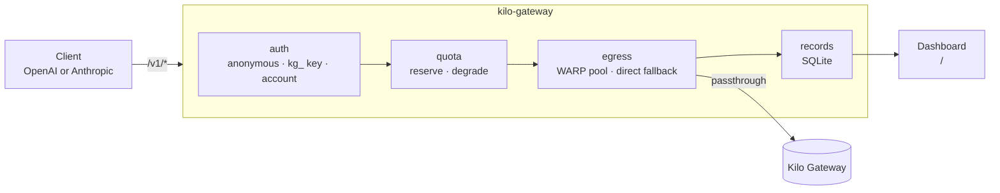

<div align="center">

# ⚡ kilo-gateway

**Every free model on Kilo, behind one endpoint.**

OpenAI- and Anthropic-compatible. Anonymous by default. Managed keys, quotas,
analytics and a dashboard — in a single binary with no runtime dependencies.

[Quick start](#quick-start) · [Dashboard](#dashboard) · [Configuration](#configuration) · [Auth](#authentication) · [How it works](#how-it-works)

</div>

---

## Why

Kilo Gateway gives you free access to a rotating catalog of frontier models.
Its API is OpenAI-shaped, which is fine until you want to point a *different*
tool at it, track who used what, cap a runaway agent, or keep a provider blip
from breaking your workflow.

`kilo-gateway` sits in front of it:

- **One endpoint, two wire protocols.** `/v1/chat/completions` (OpenAI) and
  `/v1/messages` (Anthropic) both work. The Anthropic path is a *faithful
  passthrough* — request body, `anthropic-version`, `anthropic-beta`, `x-api-key`
  and the SSE event stream cross the gateway untouched.
- **Nothing to install.** One compiled binary. No Python, no Node, no Redis, no
  Postgres. State is a SQLite file.
- **Anonymous-first.** It works with zero configuration. Add keys and accounts
  when you want accounting, not before.
- **Never fails on a rate limit.** Burn through your quota and the request
  degrades to the anonymous tier instead of returning `429`.
- **Egress you control.** Rotate upstream traffic through WARP or any HTTP
  CONNECT proxy, with direct fallback so a dead tunnel costs latency, not a request.

## Quick start

### One-shot install

<table>
<tr><th>Linux</th><th>Windows</th></tr>
<tr><td>

```sh
curl -fsSL https://raw.githubusercontent.com/therealfreddied/kilo-gateway/main/install.sh | sh
```

</td><td>

```powershell
irm https://raw.githubusercontent.com/therealfreddied/kilo-gateway/main/install.ps1 | iex
```

</td></tr>
<tr><th>Termux (Android)</th><th>From source</th></tr>
<tr><td>

```sh
pkg install bun git
curl -fsSL https://raw.githubusercontent.com/therealfreddied/kilo-gateway/main/install.sh | sh
```

</td><td>

```sh
git clone https://github.com/therealfreddied/kilo-gateway
cd kilo-gateway && bun install
bun src/server.ts
```

</td></tr>
</table>

Then open **http://127.0.0.1:8080/**.

### Talk to it

```bash
# OpenAI wire
curl http://127.0.0.1:8080/v1/chat/completions \
  -H 'content-type: application/json' \
  -d '{"model":"kilo-auto/free","messages":[{"role":"user","content":"hi"}]}'
```

```bash
# Anthropic wire — point Claude Code or the Anthropic SDK straight at it
export ANTHROPIC_BASE_URL="http://127.0.0.1:8080"
export ANTHROPIC_API_KEY=""            # must be explicitly empty
export ANTHROPIC_AUTH_TOKEN="sk-..."   # your Kilo key, or a kg_ gateway key
export ANTHROPIC_MODEL="anthropic/claude-sonnet-4.5"
```

## Dashboard

A single-file dashboard ships inside the binary — charts, live request log,
streaming playground, key management, account management, egress policy.



The dashboard needs no login on a fresh install. Set `ADMIN_TOKEN` to close it.

## Authentication

Three credentials, each for a different job.

| Credential | For | Created by |
|---|---|---|
| *none* | anonymous access — the default | — |
| `kg_…` **gateway key** | apps and agents you want metered | Dashboard → API keys |
| **account** (device flow) | humans using the dashboard | `bun src/authflow.ts` |

Gateway keys never leave the box: only a SHA-256 is stored, and the secret is
shown once at creation.

### Signing a terminal in (RFC 8628 device flow)

```bash
bun src/authflow.ts http://127.0.0.1:8080 --out ./credentials.json
```

It prints a code, you approve it in the browser at `/device`, and the terminal
receives a bearer token in a `credentials.json`:

```json
{
  "schemaVersion": 1,
  "apiBaseUrl": "http://127.0.0.1:8080",
  "accessToken": "kgd_…",
  "authStyle": "bearer",
  "expiresAt": "2026-12-25T…",
  "user": { "id": "…", "name": "…", "email": "…" }
}
```

## Quotas that degrade instead of failing

A gateway key can carry `rpm` and `daily_limit`. When it runs out, the request
is **not** rejected — it drops to the anonymous tier, which is why an agent
that hits a limit keeps working:

```http
HTTP/1.1 200 OK
x-gateway-tier: anonymous
x-gateway-degraded: rpm
retry-after: 60
```

Quota checks and reservations happen in one synchronous step, so a concurrent
burst cannot race past the limit, and reservations are ticketed so a request
that fails or is rejected gives its slot back.

## Egress

Set `EGRESS_PROXIES` to one or more HTTP CONNECT proxies (such as
[warp-minimal](https://github.com/therealfreddied/warp-minimal)) and traffic
rotates across them. A `429`, `403` or proxy-side `5xx` on one exit is retried
on the next **before a byte reaches the client**.

| Traffic | Egress |
|---|---|
| Anonymous | WARP pool always (`ANON_EGRESS=direct` opts out) |
| Key, unpinned | `AUTH_EGRESS` (`auto` = pool when configured) |
| Key, pinned | `direct` or `warp`, per key |

When every exit is unreachable the gateway retries the request directly rather
than failing it, and says so:

```http
x-gateway-egress: direct
x-gateway-egress-retries: 2
```

> **Bun only.** Node's `fetch` has no `proxy` option and silently ignores one,
> so under Node the pool is disabled and `/health` reports
> `"proxy_supported": false`. Rotation needs Bun.

## Configuration

Every value has a safe default. `.env` is loaded automatically.

| Variable | Default | Meaning |
|---|---|---|
| `PORT` | `8080` | Listen port |
| `HOST` | `127.0.0.1` | Bind address |
| `ADMIN_TOKEN` | *(empty)* | Closes the dashboard; the only thing that does |
| `REQUIRE_KEY` | `0` | Require a key on `/v1` |
| `DATA_DIR` | `./data` | SQLite location |
| `RETENTION_DAYS` | `30` | Request-log retention |
| `KILO_UPSTREAM` | `https://api.kilo.ai/api/gateway` | Upstream base |
| `EGRESS_PROXIES` | *(empty)* | Comma-separated CONNECT proxies |
| `ANON_EGRESS` | `warp` | `warp` or `direct` |
| `AUTH_EGRESS` | `auto` | `auto`, `warp` or `direct` |
| `KILO_KEYS` | *(empty)* | Comma-separated upstream credentials |
| `CATALOG_TTL_MS` | `300000` | Free-model refresh interval |
| `MAX_BODY_BYTES` | `33554432` | Request body cap |
| `ACCESS_LOG` | `0` | Per-request stdout logging |

Upstream credentials live in `~/.kilo-gateway/keys.json` (mode `600`), written
atomically, and are also editable from **Settings → Upstream accounts**.

## How it works

```
src/core.ts      Web-standard handle(request, env) — no runtime APIs
src/server.ts    node:http entry — runs on Bun AND Node
src/main.ts      Bun entry (idleTimeout, maxRequestBodySize)
src/proxy.ts     wire-transparent forwarding, quotas, usage accounting
src/accounts.ts  device-flow auth, sessions, tokens
src/keypool.ts   upstream credential pool with cooldown
src/egress.ts    exit rotation, failure decay, direct fallback
src/db.ts        SQLite store; migrations run on boot
cfwork/          pass-through Cloudflare Worker
```

The core is runtime-neutral, so the same code backs the Bun entry, the Node
entry, the Worker, and the tests.

### Run it your way

```bash
bun src/server.ts                    # Bun (recommended)
node src/server.ts                   # Node 22+
bun build --compile src/server.ts --outfile kilo-gateway   # single binary
cd cfwork && npx wrangler deploy     # Cloudflare Worker (passthrough only)
```

### Develop

```bash
bun test              # 134 tests, no network required
bun run typecheck
```

## Health

```bash
curl http://127.0.0.1:8080/health
```

```json
{
  "ok": true,
  "version": "1.0.0",
  "uptime_s": 3600,
  "mode": "configured",
  "keys_configured": 3,
  "anonymous": "warp",
  "egress": { "enabled": true, "proxy_supported": true, "proxies": ["…"] }
}
```

`/readyz` reports database and catalog readiness separately, so a load balancer
can distinguish "process up" from "can serve traffic".

## Notes and limits

- **The dashboard is open by default.** Set `ADMIN_TOKEN` before exposing the
  port to anything but localhost.
- **WARP rotation is Bun-only** (see above).
- **`anthropic/claude-sonnet-4.5` and other paid models** need a real Kilo key
  with entitlement; free models never do.
- **Single process.** SQLite is assumed to be owned by one gateway instance.

## License

MIT

<div align="center"><sub>Not affiliated with Kilo. Built for people who want their tools to keep working.</sub></div>
